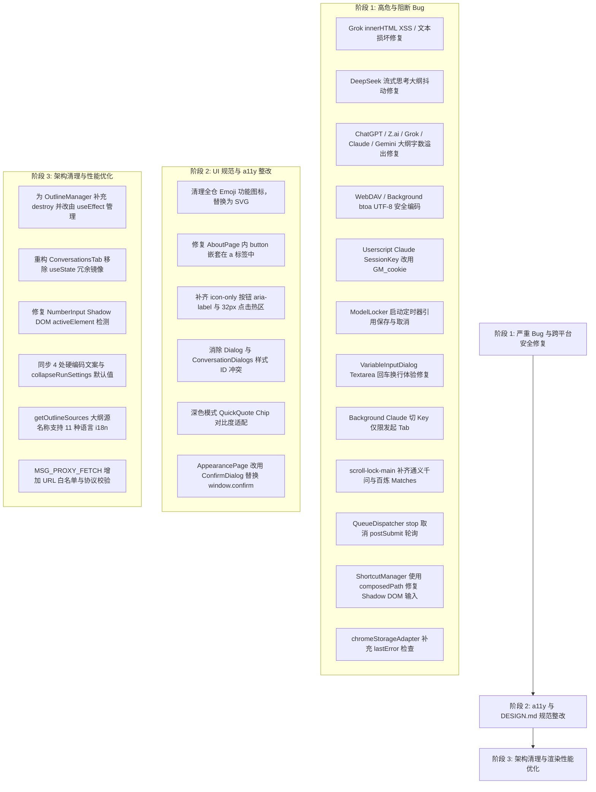

# Ophel Atlas 全仓代码深度静态分析与审查报告 - Gemini 3.7

本审查针对 Ophel Atlas 进行了全仓代码静态分析，涵盖 **站点适配器（`src/adapters/`）**、**核心管理器与生命周期（`src/core/`）**、**状态管理与持久化（`src/stores/`）**、**Shadow DOM UI 面板与选项页（`src/components/`, `src/tabs/`, `src/styles/`）**、**跨平台抽象与脚本注入层（`src/platform/`, `src/contents/`）** 以及 **11 种语言国际化体系（`src/locales/`, `locales/`）**。

报告首先对历史审查提出的 **26 项结论** 进行了逐一源码核对与真实性评估（确认 **25 项真实存在**，**1 项确认为误报** 并给出架构机理解析）；随后补充了本次深度静态分析新挖掘出的 **10 项代码 Bug / 逻辑缺陷**、**多项 UI / 交互 / a11y / DESIGN.md 规范优化点**、**国际化硬编码遗漏** 与 **跨平台/内存泄漏架构改进项**。

---

## 目录
1. [一、审查总览与基准质量指标](#一审查总览与基准质量指标)
2. [二、历史结论真实性核查与分析](#二历史结论真实性核查与分析)
3. [三、🚨 代码 Bug 与逻辑缺陷（23 项核实与新增）](#三-代码-bug-与逻辑缺陷23-项核实与新增)
4. [四、🎨 UI / 交互体验与 DESIGN.md 规范优化](#四-ui--交互体验与-designmd-规范优化)
5. [五、🌐 国际化多语言与设置系统一致性](#五-国际化多语言与设置系统一致性)
6. [六、⚡ 架构、生命周期、跨平台与性能分析](#六-架构生命周期跨平台与性能分析)
7. [七、📋 优先整改路线图与行动方案](#七-优先整改路线图与行动方案)

---

## 一、审查总览与基准质量指标

| 质量检查项 | 执行命令 / 检查方式 | 结果与结论 |
| :--- | :--- | :--- |
| **TypeScript 类型检查** | `tsc --noEmit` (`pnpm typecheck`) | **0 错误**（全仓类型系统通过） |
| **ESLint 静态代码规范** | `eslint .` (`pnpm lint:check`) | **0 错误，112 告警**（主要为 `@typescript-eslint/no-explicit-any` 和少量调试日志） |
| **Prettier 格式规范** | `prettier --check .` (`pnpm format:check`) | **全部通过** |
| **Chrome MV3 扩展构建** | `pnpm build` | **构建成功**（生产产物完整输出，无构建异常） |
| **Tampermonkey 油猴构建** | `pnpm build:userscript` | **构建成功**（资源打包受控于 GreasyFork 2MB 限制内） |
| **11 种语言 i18n 键值对齐** | AST 级自动化遍历比对 | **1644 个键 100% 对齐**，11 语言 `locales/*/messages.json` 完整 |

---

## 二、历史结论真实性核查与分析

针对历史报告中的 26 个问题点，我们对照当前最新代码进行了逐行核实：

| 历史报告条目 | 问题简述 | 当前代码状态 | 评估结论 |
| :--- | :--- | :--- | :--- |
| **二.1** | Grok 富文本 Prompt 插入 `innerHTML` | [`src/adapters/grok.ts:L1339`](file:///D:/workspace/ophel/src/adapters/grok.ts#L1339) 仍为 `innerHTML = \`<p>\${content}</p>\`` | ✅ **真实存在** |
| **二.2** | DeepSeek 流式思考误识别为 User Query | [`src/adapters/deepseek.ts:L555-L574`](file:///D:/workspace/ophel/src/adapters/deepseek.ts#L555-L574) 缺少对用户消息容器校验 | ✅ **真实存在** |
| **二.3** | ChatGPT & Z.ai 大纲末尾标题字数跨轮次死循环与溢出 | [`src/adapters/chatgpt.ts:L3543-L3569`](file:///D:/workspace/ophel/src/adapters/chatgpt.ts#L3543-L3569), [`src/adapters/zai.ts:L615-L635`](file:///D:/workspace/ophel/src/adapters/zai.ts#L615-L635) `foundCurrent` 恒假 | ✅ **真实存在** |
| **二.4** | Z.ai `extractOutline` 缺少 userQuerySelector 提前返回 | [`src/adapters/zai.ts:L548-L550`](file:///D:/workspace/ophel/src/adapters/zai.ts#L548-L550) 阻断纯标题大纲 | ✅ **真实存在** |
| **二.5** | `modules-init.ts` `CopyManager` 热更新漏传 `adapter` | [`src/core/modules-init.ts:L683`](file:///D:/workspace/ophel/src/core/modules-init.ts#L683) 构造函数单参 | ✅ **真实存在** |
| **二.6** | `backup-codec.ts` 提示词备份遗漏 `folders` 与 `tags` | [`src/core/backup-codec.ts:L50-L54`](file:///D:/workspace/ophel/src/core/backup-codec.ts#L50-L54) | ❌ **误报 (False Positive)**<br>见下方机理解析 |
| **二.7** | WebDAV / Background 原生 `btoa` 非 ASCII 异常 | [`src/core/webdav-sync.ts:L669`](file:///D:/workspace/ophel/src/core/webdav-sync.ts#L669), [`src/background.ts:L609`](file:///D:/workspace/ophel/src/background.ts#L609) | ✅ **真实存在** |
| **二.8** | 油猴 Storage Polyfill `watch` 单 key 监听器为空 | [`src/platform/userscript/storage-polyfill.ts:L57-L60`](file:///D:/workspace/ophel/src/platform/userscript/storage-polyfill.ts#L57-L60) | ✅ **真实存在** |
| **二.9** | 水印移除下载/复制 catch 吞异常且阻断原生行为 | [`src/core/watermark-remover.ts:L952-L978`](file:///D:/workspace/ophel/src/core/watermark-remover.ts#L952-L978) | ✅ **真实存在** |
| **三.1** | ClaudeSettings 未定义 CSS 变量 `--gh-primary-rgb` | [`src/tabs/options/pages/ClaudeSettings.tsx:L568`](file:///D:/workspace/ophel/src/tabs/options/pages/ClaudeSettings.tsx#L568) | ✅ **真实存在** |
| **三.2** | QuickQuote Chip 在深色宿主下对比度不足 | [`src/components/QuickQuoteActions.tsx:L340-L344`](file:///D:/workspace/ophel/src/components/QuickQuoteActions.tsx#L340-L344) | ✅ **真实存在** |
| **三.3** | 下拉菜单选中文字硬编码 `#ffffff` | [`src/components/ui/SelectDropdown.tsx:L345`](file:///D:/workspace/ophel/src/components/ui/SelectDropdown.tsx#L345) | ✅ **真实存在** |
| **三.4** | Dialog 与 ConversationDialogs `<style id="gh-dialog-styles">` 冲突 | [`src/components/ui/Dialog.tsx:L103`](file:///D:/workspace/ophel/src/components/ui/Dialog.tsx#L103), [`src/components/ConversationDialogs.tsx:L99`](file:///D:/workspace/ophel/src/components/ConversationDialogs.tsx#L99) | ✅ **真实存在** |
| **三.5** | 功能图标使用 Emoji 违规 | `ClaudeSettings.tsx`, `OutlineTab.tsx:L534`, `QuickButtons.tsx:L939`, `GlobalSearchResultItemView.tsx:L139` | ✅ **真实存在** |
| **三.6** | `<button>` 嵌套在 `<a>` 标签内 | [`src/tabs/options/pages/AboutPage.tsx:L133, L155, L178`](file:///D:/workspace/ophel/src/tabs/options/pages/AboutPage.tsx#L133) | ✅ **真实存在** |
| **三.7** | Icon-only 按钮无 `aria-label` 与热区偏小 | `MainPanel.tsx:L1488-L1514`, `QuickButtons.tsx:L876`, `ShortcutsPage.tsx:L139` | ✅ **真实存在** |
| **四.1** | 提示词分类删除硬编码中文回退 `"未分类"` | [`src/stores/prompts-store.ts:L76`](file:///D:/workspace/ophel/src/stores/prompts-store.ts#L76), [`src/core/prompt-manager.ts:L74`](file:///D:/workspace/ophel/src/core/prompt-manager.ts#L74) | ✅ **真实存在** |
| **四.2** | 散落的未抽取硬编码文本（4 处） | `QueueOverlay.tsx:L581`, `ClaudeSettings.tsx:L716`, `SelectDropdown.tsx:L309`, `GlobalSearchOverlay.tsx:L286` | ✅ **真实存在** |
| **四.3** | `collapseRunSettings` 漏同步默认设置与 Schema | [`src/constants/default-settings.ts:L339-L348`](file:///D:/workspace/ophel/src/constants/default-settings.ts#L339-L348) | ✅ **真实存在** |
| **五.1** | `OutlineManager` 缺少 `destroy()` 导致事件/Store 泄漏 | [`src/core/outline-manager.ts:L148-L156`](file:///D:/workspace/ophel/src/core/outline-manager.ts#L148-L156) | ✅ **真实存在** |
| **五.2** | `ThemeManager.destroy()` 遗漏媒体查询监听注销 | [`src/core/theme-manager.ts:L107, L1274-L1277`](file:///D:/workspace/ophel/src/core/theme-manager.ts#L107) | ✅ **真实存在** |
| **五.3** | `ConversationsTab` 双重状态镜像与级联重渲染 | [`src/components/ConversationsTab.tsx:L152-L242`](file:///D:/workspace/ophel/src/components/ConversationsTab.tsx#L152-L242) | ✅ **真实存在** |
| **五.4** | `NumberInput` 在 Shadow DOM 中焦点检测失效 | [`src/components/ui/NumberInput.tsx:L122`](file:///D:/workspace/ophel/src/components/ui/NumberInput.tsx#L122) | ✅ **真实存在** |
| **五.5** | `MSG_PROXY_FETCH` 缺乏协议与目标白名单校验 | [`src/background.ts:L566-L599`](file:///D:/workspace/ophel/src/background.ts#L566-L599) | ✅ **真实存在** |

### 🔍 历史条目 二.6（提示词备份遗漏 folders 与 tags）误报原因分析
- **架构事实**：
  1. 在 Ophel Atlas 数据模型中，`Prompt` 接口（[`src/utils/storage.ts:L80-L89`](file:///D:/workspace/ophel/src/utils/storage.ts#L80-L89)）直接使用 `category: string` 字段记录分类名称，并不依赖任何 `folderId` 或 `tags`。
  2. `folders`（`useFoldersStore`）和 `tags`（`useTagsStore`）是**会话管理（Conversations）专属**的数据结构。
  3. `BACKUP_TYPE_KEYS.prompts` 定义为 `["prompts", "promptChains"]`，已完整包含了所有提示词及其分类、置顶、链式提示词数据。
  4. 因此，原报告认为“提示词备份丢失文件夹与标签”系将会话文件夹与提示词分类混淆导致的**误报**。

---

## 三、🚨 代码 Bug 与逻辑缺陷（含历史真实项与新增项）

### 1. Grok 适配器：富文本 Prompt 插入直接拼接 `innerHTML` 导致格式破坏与 XSS 风险
- **文件位置**：[`src/adapters/grok.ts:L1339`](file:///D:/workspace/ophel/src/adapters/grok.ts#L1339)
- **问题代码**：
  ```ts
  editor.innerHTML = `<p>${content}</p>`
  ```
- **问题分析**：直接将 Prompt 文本未转义插入 contenteditable 节点的 `innerHTML` 中。若 Prompt 包含 HTML 特殊字符（如 `<template>`, `a < b && c > d`），字符会被解析为 DOM 元素或被浏览器丢弃；多行换行 `\n` 也不会被转为多段落，破坏富文本编辑器状态。
- **修复建议**：
  ```ts
  const paragraphs = content.split("\n").map(line => `<p>${escapeHtml(line) || "<br>"}</p>`).join("")
  editor.innerHTML = paragraphs
  ```

---

### 2. DeepSeek 适配器：流式思考阶段将 Assistant 思考块误识别为 User Query 塞入大纲
- **文件位置**：[`src/adapters/deepseek.ts:L555-L574`](file:///D:/workspace/ophel/src/adapters/deepseek.ts#L555-L574)
- **问题分析**：在 DeepSeek R1 深度思考流式输出阶段，页面正文 `.ds-markdown` 尚未生成，`getAssistantBodyMarkdown(message)` 返回 `null`。由于未校验 `message` 是否为真实用户消息，代码 fallback 进入 `extractUserQueryMarkdown` 分支，把 Assistant 的思考过程当作用户提问加入了大纲。正文渲染后又突变为 Assistant 标题，导致大纲剧烈闪烁。
- **修复建议**：
  ```ts
  const isUserMessage = Boolean(this.resolveUserMessageElement(message))
  if (!markdown) {
    if (!isUserMessage || !includeUserQueries) return
    // ...
  }
  ```

---

### 3. ChatGPT & Z.ai 适配器：大纲末尾标题字数跨轮次计算死循环与数万字溢出
- **文件位置**：[`src/adapters/chatgpt.ts:L3543-L3569`](file:///D:/workspace/ophel/src/adapters/chatgpt.ts#L3543-L3569)、[`src/adapters/zai.ts:L615-L635`](file:///D:/workspace/ophel/src/adapters/zai.ts#L615-L635)
- **问题分析**：
  ```ts
  for (const uq of allUserQueries) {
    if (foundCurrent) { nextUserQuery = uq; break; }
    if (uq === startEl || uq.contains(startEl) || startEl.contains(uq)) {
      foundCurrent = true // ⚠️ startEl 是 AI 回复里的 h1~h6，与 uq（用户提问）绝不可能相等或相互包含
    }
  }
  ```
  `foundCurrent` 恒为 `false`，导致 `nextUserQuery` 恒为 `null`。代码最终执行 `calculateRangeWordCount(startEl, null, lastAssistant)`，将从当前标题一直到全会话**最后一个 Assistant 回复**的全部文本都算作该标题的字数。
- **修复建议**：
  ```ts
  nextUserQuery = allUserQueries.find(uq => Boolean(startEl.compareDocumentPosition(uq) & Node.DOCUMENT_POSITION_FOLLOWING)) || null
  ```

---

### 4. Z.ai 适配器：`extractOutline` 缺少用户提问选择器时提前返回导致大纲全部丢失
- **文件位置**：[`src/adapters/zai.ts:L548-L550`](file:///D:/workspace/ophel/src/adapters/zai.ts#L548-L550)
- **问题分析**：
  ```ts
  const userQuerySelector = this.getUserQuerySelector()
  if (!userQuerySelector) return outline
  ```
  即使用户仅请求抽取标题大纲（`includeUserQueries = false`），只要 `getUserQuerySelector()` 为空，函数就直接返回空数组 `[]`，页面所有有效标题全部被丢弃。
- **修复建议**：仅在 `includeUserQueries === true` 时才对 `userQuerySelector` 进行非空阻断。

---

### 5. `modules-init.ts`：`CopyManager` 热更新重建时遗漏 `adapter` 参数
- **文件位置**：[`src/core/modules-init.ts:L683`](file:///D:/workspace/ophel/src/core/modules-init.ts#L683)
- **问题分析**：在设置热更新重建 `CopyManager` 时仅传入了单参 `new CopyManager(newSettings.content)`，导致实例内的 `this.siteAdapter` 变为 `null`，后续公式定制提取与 Shadow DOM 站点表格复制按钮挂载失效。
- **修复建议**：补齐参数 `modules.copyManager = new CopyManager(newSettings.content, adapter)`。

---

### 6. WebDAV 同步与 Background 代理：原生 `btoa` 编码含非 ASCII 字符时抛错崩溃
- **文件位置**：[`src/core/webdav-sync.ts:L669`](file:///D:/workspace/ophel/src/core/webdav-sync.ts#L669)、[`src/background.ts:L609`](file:///D:/workspace/ophel/src/background.ts#L609)
- **问题分析**：原生 `btoa` 仅支持 Latin1 字符集。若用户名或密码包含中文、特殊符号或 Emoji，直接抛出 `InvalidCharacterError` 异常中断同步。
- **修复建议**：
  ```ts
  const credentials = btoa(unescape(encodeURIComponent(`${username}:${password}`)))
  ```

---

### 7. 油猴脚本 Storage Polyfill：`watch` 单 Key 监听器回调函数为空
- **文件位置**：[`src/platform/userscript/storage-polyfill.ts:L57-L60`](file:///D:/workspace/ophel/src/platform/userscript/storage-polyfill.ts#L57-L60)
- **问题分析**：单 key 监听分支的 `GM_addValueChangeListener` 回调体为空，注册单 key 监听时调用方永远无法收到通知。
- **修复建议**：补齐监听器分发逻辑。

---

### 8. 移除水印下载与复制按钮：异常处理静默吞掉且彻底阻断原生行为
- **文件位置**：[`src/core/watermark-remover.ts:L952-L978`](file:///D:/workspace/ophel/src/core/watermark-remover.ts#L952-L978)
- **问题分析**：点击事件前置执行了 `event.stopImmediatePropagation()`。随后在 `catch` 块中若发生异常直接 `return` 吞掉，无 toast 提示且彻底阻断了原生下载/复制。
- **修复建议**：在 `catch` 中补充 `showToast` 并提供原图直链下载兜底。

---

### 9. `ModelLocker`：启动定时器未保存引用导致 `stop()` / `relock()` 无法清理
- **文件位置**：[`src/core/model-locker.ts:L56, L153-L165`](file:///D:/workspace/ophel/src/core/model-locker.ts#L56)
- **问题分析**：
  ```ts
  start(delay = 1500) {
    if (!this.config.enabled || !this.config.keyword) return
    if (this.isLocked) return

    setTimeout(() => { // ⚠️ 未将 timer ID 保存到 this.startTimer
      if (this.isLocked) return
      this.adapter.lockModel(...)
    }, delay)
  }
  ```
  在 1.5 秒延时期间如果发生页面卸载、用户关闭模型锁定或调用 `stop()` / `relock()`，`stop()` 仅清理了 `verifyTimer` 和 `configDebounceTimer`，无法取消挂起的 `start` 定时器。定时器到期后仍然会强制触发模型切换，引发非预期的切模型弹窗与 UI 干扰。
- **修复建议**：在类属性中增加 `private startTimer: ReturnType<typeof setTimeout> | null = null`，并在 `start()` 中赋值、在 `stop()` 中 `clearTimeout(this.startTimer)`。

---

### 10. 油猴平台 Claude 切换 SessionKey：`document.cookie` 无法读写 HttpOnly Cookie 且未调用 `GM_cookie`
- **文件位置**：[`src/platform/userscript/index.ts:L209-L210, L289, L353`](file:///D:/workspace/ophel/src/platform/userscript/index.ts#L209)
- **问题分析**：
  1. Claude 站点的 `sessionKey`（`sk-ant-sid01-...`）由 Cloudflare/Anthropic 设置为 `HttpOnly`。
  2. 油猴脚本中通过 `document.cookie.match(/sessionKey=([^;]+)/)` 读取 Cookie 恒返回 `null`；通过 `document.cookie = "sessionKey=..."` 也无法覆盖服务端的 HttpOnly Cookie。
  3. 构建配置 [`vite.userscript.config.ts:L629`](file:///D:/workspace/ophel/vite.userscript.config.ts#L629) 中已经申请了 `GM_cookie` 权限，但代码中从未调用 `GM_cookie.get` / `GM_cookie.set`。
- **修复建议**：在 `src/platform/userscript/index.ts` 中优先使用 `GM_cookie.get` 和 `GM_cookie.set` 读写 HttpOnly 会话 Cookie。

---

### 11. Grok 适配器：字数统计 fallback 逻辑仅检查 immediate sibling 导致溢出累加
- **文件位置**：[`src/adapters/grok.ts:L2246-L2252`](file:///D:/workspace/ophel/src/adapters/grok.ts#L2246-L2252)
- **问题分析**：
  ```ts
  const nextUserQuery =
    startEl.parentElement?.nextElementSibling?.querySelector(userQuerySelector)
  ```
  在 Grok 的 DOM 树中，用户消息父容器的 `nextElementSibling` 是紧随其后的 AI 回复容器（而非下一个用户消息）。因此 `nextUserQuery` 恒为 `null`，导致后续循环无法命中 `isBeforeEnd` 终止条件，把全会话后续所有轮次的 AI 回复字数全部累加到了当前轮次中。
- **修复建议**：使用 `startEl.closest(...)` 向上查找并通过 `compareDocumentPosition` 确定真实下一个用户提问。

---

### 12. `VariableInputDialog`：弹窗捕获 Enter 导致多行 Textarea 无法输入换行直接早退提交
- **文件位置**：[`src/components/VariableInputDialog.tsx:L101-L105, L225-L236`](file:///D:/workspace/ophel/src/components/VariableInputDialog.tsx#L101)
- **问题分析**：
  外层容器监听了 `handleKeyDown`：`if (e.key === "Enter" && !e.shiftKey) { e.preventDefault(); handleSubmit(); }`。尽管输入框被设计为支持多行自适应伸缩（最高 200px）的 `<textarea>`，用户在输入框中按普通 Enter 期望换行时，会被外层拦截并立即提交弹窗，破坏多行提示词变量的输入体验。
- **修复建议**：在 `handleKeyDown` 中判断如果当前事件焦点处于 `textarea` 中且非 `Ctrl+Enter` / `Cmd+Enter`，允许原生回车换行。

---

### 13. Background Claude 切 Key 操作无差别重定向全部已打开的 Claude 标签页
- **文件位置**：[`src/background.ts:L992-L995`](file:///D:/workspace/ophel/src/background.ts#L992-L995)
- **问题分析**：
  ```ts
  const claudeTabs = await chrome.tabs.query({ url: "*://claude.ai/*" })
  for (const tab of claudeTabs) {
    if (tab.id) await chrome.tabs.update(tab.id, { url: "https://claude.ai/" })
  }
  ```
  用户在某个标签页中点击“切换下一个 Key”时，后台无差别遍历了浏览器内**所有窗口中打开的所有 Claude 标签页**并全部强制刷新跳转到首页，导致其他标签页中正在进行的长文浏览或未保存草稿全部丢失。
- **修复建议**：优先只刷新发起请求的当前活动标签页 `sender.tab.id`。

---

### 14. 🆕 【新发现】Claude 适配器：跨轮次标题字数边界越界，包含后续轮次用户提问与操作栏
- **文件位置**：[`src/adapters/claude.ts:L1952-L1973`](file:///D:/workspace/ophel/src/adapters/claude.ts#L1952-L1973)
- **问题分析**：
  ```ts
  for (let i = index + 1; i < headings.length; i++) {
    const candidate = headings[i]
    const candidateLevel = parseInt(candidate.tagName[1])
    if (candidateLevel <= level) {
      nextBoundaryEl = candidate
      break
    }
  }
  ```
  `headings` 是从整个会话所有回复中拉取的扁平数组。如果当前标题是本轮回复的最后一个标题，下一个同级标题可能存在于**下一轮或更晚的 AI 回复中**。此时 `nextBoundaryEl` 指向未来轮次的元素，导致 `calculateRangeWordCount(h, nextBoundaryEl, responseContainer)` 构造的 Range 横跨多个对话轮次，将中途的用户提问、时间戳、操作按钮文本全部计入字数。
- **修复建议**：将 `nextBoundaryEl` 限制在当前 `responseContainer` 作用域内；若当前容器内无后续同级标题，传入 `null` 并以当前 `responseContainer` 作为 Range 终止边界。

---

### 15. 🆕 【新发现】Gemini 适配器：大纲字数统计在多轮对话中跨 MessageContent 边界溢出
- **文件位置**：[`src/adapters/gemini.ts:L5544-L5546`](file:///D:/workspace/ophel/src/adapters/gemini.ts#L5544-L5546)
- **问题分析**：
  ```ts
  const messageContent = startEl.closest(privateSelectors.outlineMessageContent)
  const count = this.calculateRangeWordCount(startEl, nextEl, messageContent || container)
  ```
  当 `nextEl` 是下一轮回复中的标题时，`nextEl` 处于 `messageContent` 之外。`document.createRange()` 的 `setEndBefore(nextEl)` 会把跨越多个轮次的消息文本全部纳入统计，导致字数虚高数倍。
- **修复建议**：校验 `messageContent.contains(nextEl)`，若不在同一消息块内则将 `endEl` 置为 `null`，使其正确收敛于当前 `messageContent` 的末尾。

---

### 16. 🆕 【新发现】`scroll-lock-main.ts`：通义千问 `qianwen.com` 与百炼 `bailian.console.aliyun.com` 漏配 Matches 导致主世界滚动锁定失效
- **文件位置**：[`src/contents/scroll-lock-main.ts:L12-L29`](file:///D:/workspace/ophel/src/contents/scroll-lock-main.ts#L12-L29)
- **问题分析**：
  扩展的 `scroll-lock-main.ts`（以 `world: "MAIN"` 运行于 `document_start` 阶段，负责劫持 `scrollIntoView` 和 `scrollTop`）的 `matches` 列表中，包含了其他所有站点，但遗漏了 `https://qianwen.com/*`、`https://www.qianwen.com/*`、`https://tongyi.aliyun.com/*` 以及 `https://bailian.console.aliyun.com/*`。导致通义千问国内版用户在流式输出时无法被主世界脚本拦截，滚动锁定功能在扩展端静默失效。
- **修复建议**：在 `matches` 列表中补齐通义千问及百炼域名的匹配规则。

---

### 17. 🆕 【新发现】`ShortcutManager`：Shadow DOM 内输入时 `e.target` 指向 Host 导致快捷键误拦截
- **文件位置**：[`src/core/shortcut-manager.ts:L91-L109`](file:///D:/workspace/ophel/src/core/shortcut-manager.ts#L91-L109)
- **问题分析**：
  ```ts
  private shouldIgnoreEvent(e: KeyboardEvent): boolean {
    const target = e.target
    // ... 检查 target.tagName === "INPUT" 等
  }
  ```
  在浏览器事件冒泡机制中，当事件跨越 Shadow Root 边界到达 `window` / `document` 捕获层时，`e.target` 会被浏览器重新定向（Retargeting）为 Shadow Host 宿主元素（如 `div#ophel-host`）。`target.tagName` 变成了 `"DIV"`，`isEditable` 判定为 `false`。用户在 Shadow DOM 内的搜索框或输入框中按单键（如配置了无修饰键快捷键）时，会被 `ShortcutManager` 拦截并执行 `preventDefault()`，导致无法正常打字。
- **修复建议**：
  ```ts
  const actualTarget = e.composedPath?.()[0] || e.target
  ```

---

### 18. 🆕 【新发现】`MarkdownFixer`：正则表达式直接替换 `innerHTML` 存在损坏 LaTeX 公式与 HTML 属性风险
- **文件位置**：[`src/core/markdown-fixer.ts:L128-L148`](file:///D:/workspace/ophel/src/core/markdown-fixer.ts#L128-L148)
- **问题分析**：
  `MarkdownFixer` 仅通过简单正则保护了 `<code>` 块，随后直接使用 `/\*\*([^*]+(?:\*(?!\*)[^*]*)*)\*\*/g` 替换整个段落的 `innerHTML`。如果段落中包含 LaTeX 数学公式（如 `$x**2 + y**2 = z**2$` 或 Python 幂运算符 `**`）或带有 Markdown 标记的 HTML 属性（如 `title="**重要**"`），正则会直接把公式内部拆解并插入 `<strong>` 标签，破坏 KaTeX/MathJax 渲染或破坏 HTML 标签结构。
- **修复建议**：增加对 `$...$`、`$$...$$`、`\(...\)` LaTeX 公式占位符保护，并在 DOM TextNode 粒度而非整段 innerHTML 字符串上做标记替换。

---

### 19. 🆕 【新发现】`QueueDispatcher`：`stop()` 无法取消长达 10 分钟的 `postSubmitWaitPromise` 异步轮询
- **文件位置**：[`src/core/queue-dispatcher.ts:L57-L60, L296-L330`](file:///D:/workspace/ophel/src/core/queue-dispatcher.ts#L57-L60)
- **问题分析**：
  在提交提示词后，调度器启动了 `waitForConversationIdleAfterSubmit()`，内部是一个最长 10 分钟、每 500ms 检查一次 DOM 状态的 `while` 循环。当用户在设置中关闭提示词队列或调用 `dispatcher.stop()` 时，`stop()` 仅停止了 `pollingTasks`，未中断 `postSubmitWaitPromise`。该 Promise 会在后台脱缰运行直至超时，持续消耗 CPU 并在完成后错误地重置 `idleCount`。
- **修复建议**：引入 `AbortController`，在 `stop()` 中触发 `abort()` 立即退出 `waitForConversationIdleAfterSubmit` 循环。

---

### 20. 🆕 【新发现】`PromptManager.init()` 等待 Hydration 无超时兜底可能造成初始化无限挂起
- **文件位置**：[`src/core/prompt-manager.ts:L36-L45`](file:///D:/workspace/ophel/src/core/prompt-manager.ts#L36-L45)
- **问题分析**：
  ```ts
  if (!usePromptsStore.getState()._hasHydrated) {
    await new Promise<void>((resolve) => {
      const unsubscribe = usePromptsStore.subscribe((state) => {
        if (state._hasHydrated) {
          unsubscribe()
          resolve()
        }
      })
    })
  }
  ```
  如果底层存储（如 `chrome.storage.local` 或油猴 `GM_getValue`）在极端情况下抛出异常或在初次加载前发生竞争，`_hasHydrated` 永远不会变为 `true`。`init()` 将永久卡在 `Promise` 中，阻塞调用方的后续初始化链路。
- **修复建议**：参考 `ReadingHistoryManager` 的实现，设置 3000ms 超时并自动兜底 resolve。

---

### 21. 🆕 【新发现】`chromeStorageAdapter`：缺少 `chrome.runtime.lastError` 校验导致写入静默失败与数据丢失
- **文件位置**：[`src/stores/chrome-adapter.ts:L97-L133`](file:///D:/workspace/ophel/src/stores/chrome-adapter.ts#L97-L133)
- **问题分析**：
  在扩展端通过 `chrome.storage.local.set/remove` 时，回调函数中未检查 `chrome.runtime.lastError`。如果存储配额超限（QUOTA_BYTES）或扩展上下文失效，Promise 仍然会被无条件 `resolve()`，导致数据丢失而无任何异常暴露。
- **修复建议**：
  ```ts
  chrome.storage.local.set({ [name]: value }, () => {
    if (chrome.runtime.lastError) {
      reject(new Error(chrome.runtime.lastError.message))
    } else {
      resolve()
    }
  })
  ```

---

### 22. 🆕 【新发现】Declarative & Base 适配器：`getOutlineSources()` 大纲源名称硬编码中文 `"对话"` / `"文档"`
- **文件位置**：[`src/adapters/base.ts:L1250`](file:///D:/workspace/ophel/src/adapters/base.ts#L1250)、[`src/adapters/claude.ts:L1789`](file:///D:/workspace/ophel/src/adapters/claude.ts#L1789)、[`src/adapters/gemini.ts:L2707`](file:///D:/workspace/ophel/src/adapters/gemini.ts#L2707)、[`src/adapters/declarative/adapter.ts:L667`](file:///D:/workspace/ophel/src/adapters/declarative/adapter.ts#L667)
- **问题分析**：
  `getOutlineSources()` 返回的数据结构中硬编码了 `label: "对话"` 与 `label: "文档"`。非中文语言用户在大纲 Tab 切换来源时，看到的标签依然是中文字符，破坏了 11 种语言的国际化体验。
- **修复建议**：改用 `t("outlineSourceConversation")` 与 `t("outlineSourceDocument")` 进行国际化分发。

---

### 23. 🆕 【新发现】`OutlineManager`：硬编码消息事件类型字符串与 TODO 注释残留
- **文件位置**：[`src/core/outline-manager.ts:L253, L257, L261`](file:///D:/workspace/ophel/src/core/outline-manager.ts#L253)
- **问题分析**：
  ```ts
  // Imports needed: EVENT_MONITOR_START, EVENT_MONITOR_COMPLETE
  // I will add them to the top of the file
  if (type === "GH_MONITOR_START" /* EVENT_MONITOR_START */) {
  ```
  代码中遗留了开发 TODO 注释，并且违反了 `AGENTS.md` 中“修改 background/content 消息时，使用 `src/utils/messaging.ts` 的常量，避免散落字符串”的架构规则。
- **修复建议**：从 `~utils/messaging` 导入 `EVENT_MONITOR_START` 与 `EVENT_MONITOR_COMPLETE` 常量。

---

## 四、🎨 UI / 交互体验与 DESIGN.md 规范优化

### 1. 引用未定义的 CSS 变量与主题破坏
- **文件位置**：[`src/tabs/options/pages/ClaudeSettings.tsx:L568`](file:///D:/workspace/ophel/src/tabs/options/pages/ClaudeSettings.tsx#L568)
- **问题**：使用了 `backgroundColor: "rgba(var(--gh-primary-rgb), 0.1)"`，但全局从未使用 `--gh-primary-rgb`，导致批量测试时高亮背景样式静默失效。
- **建议**：改用 CSS 标准 `color-mix(in srgb, var(--gh-primary) 12%, transparent)`。

### 2. 快捷引用 Chip 在深色宿主页面对比度不足
- **文件位置**：[`src/components/QuickQuoteActions.tsx:L340-L344`](file:///D:/workspace/ophel/src/components/QuickQuoteActions.tsx#L340-L344)
- **问题**：向页面注入的样式中硬编码 `color: #2563eb !important; background: rgba(66, 133, 244, 0.07)`。在 ChatGPT / Claude / Gemini 深色模式下对比度仅 ~2.3:1（远低于 WCAG AA 4.5:1）。
- **建议**：注入样式中使用 `var(--gh-primary, #3b82f6)` 并在深色模式下提供高对比度配色。

### 3. 下拉菜单选中项文字硬编码 `#ffffff`
- **文件位置**：[`src/components/ui/SelectDropdown.tsx:L345`](file:///D:/workspace/ophel/src/components/ui/SelectDropdown.tsx#L345)
- **问题**：`color: isSelected ? "#ffffff" : "var(--gh-text)"`。在明亮浅色主题（如亮黄、薄荷绿）下，白色文字落在浅色背景上无法阅读。
- **建议**：改用语义变量 `var(--gh-text-on-primary, #ffffff)`。

### 4. 弹窗 `<style id="gh-dialog-styles">` 命名碰撞与样式覆盖
- **文件位置**：[`src/components/ui/Dialog.tsx:L98-L106`](file:///D:/workspace/ophel/src/components/ui/Dialog.tsx#L98-L106)、[`src/components/ConversationDialogs.tsx:L94-L102`](file:///D:/workspace/ophel/src/components/ConversationDialogs.tsx#L94-L102)
- **问题**：两处分别定义了不同的弹窗 CSS 内容，但都注入为 `id="gh-dialog-styles"`。后挂载的组件由于 ID 已存在而跳过注入，导致部分特定弹窗样式丢失。
- **建议**：区分样式 ID 或统一合并至 `src/styles/` 入口注入。

### 5. 功能图标使用 Emoji 违规
- **文件位置**：
  - [`src/tabs/options/pages/ClaudeSettings.tsx:L462-L653`](file:///D:/workspace/ophel/src/tabs/options/pages/ClaudeSettings.tsx#L462)（大量使用 `🔑`, `⚠️`, `➕`, `⚡`, `🌐`, `📥`, `📤`, `✓`, `✗` 充当操作图标）
  - [`src/components/OutlineTab.tsx:L534`](file:///D:/workspace/ophel/src/components/OutlineTab.tsx#L534)（`💬` 充当用户提问标识）
  - [`src/components/QuickButtons.tsx:L939`](file:///D:/workspace/ophel/src/components/QuickButtons.tsx#L939)（`📍` 充当锚点 fallback）
  - [`src/components/global-search/GlobalSearchResultItemView.tsx:L139`](file:///D:/workspace/ophel/src/components/global-search/GlobalSearchResultItemView.tsx#L139)（`💡` 充当提示图标）
- **违规条款**：`DESIGN.md` 3.2 与 5.5（“不在界面中使用装饰性表情符号，不使用 emoji 代替功能图标”）。
- **建议**：统一迁移为 `~components/icons` 内的 SVG 组件。

### 6. HTML 语义标准违规：`<button>` 嵌套在 `<a>` 标签内
- **文件位置**：[`src/tabs/options/pages/AboutPage.tsx:L133, L155, L178, L303, L318`](file:///D:/workspace/ophel/src/tabs/options/pages/AboutPage.tsx#L133)
- **问题**：在关于页链接卡片中，外层为 `<a href=...>`，内层嵌套了 `<button type="button" className="about-link-btn">`。HTML5 规范严格禁止交互性元素相互嵌套。
- **建议**：内层 `<button>` 替换为 `<span className="about-link-btn" aria-hidden="true">`。

### 7. Icon-only 按钮无 `aria-label` 与热区偏小
- **文件位置**：
  - [`src/components/MainPanel.tsx:L1488-L1520, L1678`](file:///D:/workspace/ophel/src/components/MainPanel.tsx#L1488)（主题切换、新标签、设置、底部锚点按钮缺少 `aria-label`，且 `.gh-header-icon-btn` 仅 24×24px）
  - [`src/components/QuickButtons.tsx:L876-L940`](file:///D:/workspace/ophel/src/components/QuickButtons.tsx#L876)（快捷悬浮按钮与手动锚点按钮缺少 `aria-label`）
  - [`src/components/VariableInputDialog.tsx:L158`](file:///D:/workspace/ophel/src/components/VariableInputDialog.tsx#L158)（关闭按钮缺少 `aria-label`）
  - [`src/tabs/options/pages/ShortcutsPage.tsx:L139`](file:///D:/workspace/ophel/src/tabs/options/pages/ShortcutsPage.tsx#L139)（删除快捷键按钮仅 26×26px 且使用纯文本 `✕`）
- **建议**：补充 `aria-label={t(...)}`，并通过 padding 确保最小 32×32px 可点击区域。

### 8. 🆕 【新发现】`AppearancePage` 使用原生阻塞式 `window.confirm()` 破坏交互体验
- **文件位置**：[`src/tabs/options/pages/AppearancePage.tsx:L209`](file:///D:/workspace/ophel/src/tabs/options/pages/AppearancePage.tsx#L209)
- **问题**：在删除自定义样式时，直接调用了原生 `if (confirm(t("confirmDeleteStyle")))`。`DESIGN.md` 第 7 节（状态设计）明确规定避免使用原生阻塞弹窗。项目内已有完善的 `ConfirmDialog` 组件。
- **建议**：改用 `ConfirmDialog` 统一确认交互。

---

## 五、🌐 国际化多语言与设置系统一致性

### 1. 提示词分类删除硬编码中文回退 `"未分类"`
- **文件位置**：[`src/stores/prompts-store.ts:L76`](file:///D:/workspace/ophel/src/stores/prompts-store.ts#L76)、[`src/core/prompt-manager.ts:L74`](file:///D:/workspace/ophel/src/core/prompt-manager.ts#L74)
- **问题代码**：`deleteCategory: (name: string, defaultCategory = "未分类") =>`
- **问题分析**：当非中文语言用户删除分类时，未显式传参会导致关联提示词被重新归类为中文字符串 `"未分类"`，污染用户国际化数据。
- **修复建议**：改为使用空字符串或调用处统一传入 `t("uncategorized")`。

### 2. 散落的未抽取硬编码文本
- **文件位置**：
  - [`src/components/QueueOverlay.tsx:L581`](file:///D:/workspace/ophel/src/components/QueueOverlay.tsx#L581)：`"队列为空，输入内容后按 ... 发送或排队"`
  - [`src/tabs/options/pages/ClaudeSettings.tsx:L716`](file:///D:/workspace/ophel/src/tabs/options/pages/ClaudeSettings.tsx#L716)：`"当前使用"`
  - [`src/components/ui/SelectDropdown.tsx:L309`](file:///D:/workspace/ophel/src/components/ui/SelectDropdown.tsx#L309)：`"No options"`
  - [`src/components/global-search/GlobalSearchOverlay.tsx:L286`](file:///D:/workspace/ophel/src/components/global-search/GlobalSearchOverlay.tsx#L286)：`aria-label="active search filters"`
- **修复建议**：提取 key 并在 11 种语言 `src/locales/*/index.ts` 中同步。

### 3. 设置项 `collapseRunSettings` 漏同步 `DEFAULT_SETTINGS` 与 JSON Schema
- **文件位置**：[`src/constants/default-settings.ts:L340-L349`](file:///D:/workspace/ophel/src/constants/default-settings.ts#L340-L349)、[`docs/developer/settings-schema.json:L357-L365`](file:///D:/workspace/ophel/docs/developer/settings-schema.json#L357-L365)
- **问题分析**：`collapseRunSettings` 已在 UI 和适配器中使用，但在 `DEFAULT_SETTINGS.aistudio` 和 `settings-schema.json` 中均缺失。
- **修复建议**：补充 `"collapseRunSettings": false` 默认值。

---

## 六、⚡ 架构、生命周期、跨平台与性能分析

### 1. `OutlineManager` 缺少 `destroy()` 方法与 Store/Window 事件泄露
- **文件位置**：[`src/core/outline-manager.ts:L148-L156`](file:///D:/workspace/ophel/src/core/outline-manager.ts#L148-L156)、[`src/components/App.tsx:L470`](file:///D:/workspace/ophel/src/components/App.tsx#L470)
- **分析**：`OutlineManager` 在构造函数中订阅了全局 `window.addEventListener("message")` 和 `useBookmarkStore.subscribe`，但未提供任何清理方法。在 `App.tsx` 中直接通过 `useMemo` 实例化，SPA 切换或重新挂载时旧实例无法被垃圾回收，闭包持有的 DOM 观察器与定时器在后台争抢运行。
- **建议**：为 `OutlineManager` 实现 `destroy()`，并在 `App.tsx` 中使用 `useEffect` 进行生命周期绑定与卸载清理。

### 2. `ThemeManager.destroy()` 遗漏系统偏好媒体查询监听注销
- **文件位置**：[`src/core/theme-manager.ts:L107, L1274-L1277`](file:///D:/workspace/ophel/src/core/theme-manager.ts#L107)
- **分析**：`ensureSystemListener` 向 `window.matchMedia("(prefers-color-scheme: dark)")` 绑定了监听，`destroy()` 时未执行 `removeEventListener`。
- **建议**：在 `destroy()` 中清理 `this.systemMediaQuery.removeEventListener("change", this.handleSystemChange)`。

### 3. `ConversationsTab` 存在状态双重镜像与级联重渲染
- **文件位置**：[`src/components/ConversationsTab.tsx:L152-L250`](file:///D:/workspace/ophel/src/components/ConversationsTab.tsx#L152-L250)
- **分析**：组件订阅了 Zustand store snapshot，同时又定义了 4 组 `useState`，并在 `useEffect` 中监听 store 变更再次 `setFolders`/`setConversations`。造成每次 store 变更发生两次全量渲染。
- **建议**：移除冗余 `useState` 镜像，直接在渲染中使用 selector 或 `useMemo` 派生数据。

### 4. `NumberInput` 在 Shadow DOM 中焦点检测失效
- **文件位置**：[`src/components/ui/NumberInput.tsx:L122`](file:///D:/workspace/ophel/src/components/ui/NumberInput.tsx#L122)
- **分析**：`document.activeElement !== inputRef.current` 在 Shadow DOM 下 `document.activeElement` 指向 shadow host，恒不等于内部 input。
- **建议**：使用 `(inputRef.current?.getRootNode() as ShadowRoot)?.activeElement` 替代。

### 5. `MSG_PROXY_FETCH` 缺乏协议与目标白名单校验
- **文件位置**：[`src/background.ts:L566-L599`](file:///D:/workspace/ophel/src/background.ts#L566-L599)
- **分析**：Background 拥有 `<all_urls>` 权限，收到 `MSG_PROXY_FETCH` 消息后直接 `fetch(message.url)`，未对 URL 协议（限制 `http:`/`https:`）及内网 IP / 本地服务端口进行拦截。
- **建议**：增加协议解析与目标白名单校验，禁止请求 `localhost`、内网 IP 段及敏感端口。

---

## 七、📋 优先整改路线图与行动方案



<!-- GOAL_COMPLETE -->