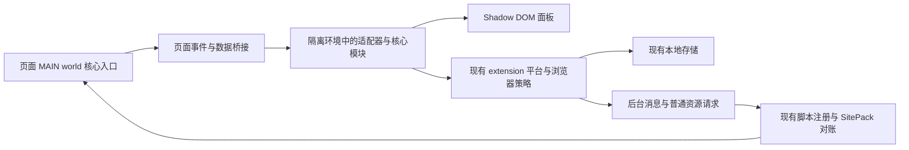

# Safari 核心功能适配分析

日期：2026-11-09。分析基线：`63f193600`（v1.3.2）。状态：待实施；本文不代表 Safari 已可用。

## 1. 结论与范围

Ophel 可以继续使用 TypeScript、React、Plasmo 和现有站点适配器实现 Safari 版本，无需重写核心业务。首期不追求与 Chrome 的增强功能完全一致，将兼容工作集中在构建配置、平台能力、后台启动和内容脚本注入。

用户已明确：保证核心功能，去水印可以不支持。本方案据此建议首期面向 **macOS Safari 18.0 及以上**；iPhone、iPad 和更早版本不纳入首期承诺。平台和版本是本方案的工程建议，仍需在真实 Safari 上验证最低版本及发布时的稳定版本，不能据此宣称已经兼容。

本文记录分析和技术决策，执行步骤见 [实施计划](implementation-plan.md)。按开发者文档的归位规则临时放在主题目录；适配落地后，把长期有效的机制合入架构文档，再删除一次性计划。

## 2. 功能边界

“支持”均指沿用各站点已有能力，不要求为原本不支持某功能的站点新增功能。

| 分类       | 功能                                             | 首期要求                                                                               |
| ---------- | ------------------------------------------------ | -------------------------------------------------------------------------------------- |
| 核心       | 面板、站点识别、SPA 会话切换、页面主环境通信     | 必须支持；不能只显示面板而收不到对话数据                                               |
| 核心       | 实时大纲、层级、折叠、搜索、定位、阅读记录和书签 | 必须支持站点原有能力，覆盖流式生成和长对话                                             |
| 核心       | 会话文件夹、标签、收藏、搜索和会话跳转           | 必须支持，刷新和重启后数据仍在                                                         |
| 核心       | Prompt 词库、组织、搜索、变量填写和插入输入框    | 必须支持，不能破坏输入框的原有交互                                                     |
| 核心       | Markdown、TXT、JSON、HTML 文本导出及复制         | 必须支持；附件失败不能阻断文本导出或被报告为完整成功                                   |
| 核心       | 设置、本地持久化、备份与恢复、语言、主题         | 必须支持；旧备份启用增强功能时也不能启动不支持的模块                                   |
| 核心       | SitePack 安装、授权、动态注册、停用及撤权        | 必须支持现有功能，包含来源绑定和重启后的注册恢复                                       |
| 核心       | 页面内快捷键、标题和生成状态管理                 | 必须支持既有基础行为；验证 macOS 修饰键与系统快捷键冲突                                |
| 增强       | Gemini 图片去水印、相关下载及复制拦截            | 首期明确不支持，不申请相关额外权限，不启动拦截器                                       |
| 增强       | 扩展桌面通知及当前与通知绑定的提示音             | 建议首期不支持，不增加原生通知桥接；生成检测、标题状态、自动聚焦分别保留和验证         |
| 增强       | 依赖改写 Origin、Referer 等请求头的受限附件下载  | 不保证离线附件完整性；普通资源请求保留，缺失附件必须可见                               |
| 非首期门槛 | Claude Cookie 账号切换、WebDAV、浏览器级命令     | 不直接删除，也不预先宣称兼容；分别验证，若发现阻塞则按真实能力限制入口，不影响核心链路 |
| 后续       | iOS、iPadOS、旧版 Safari、原生 Swift 功能        | 单独评估和验收，不混入桌面核心适配                                                     |

桌面通知、提示音和非首期门槛的划分属于本方案建议；用户已明确可舍弃的具体功能是去水印。实施时应公开支持范围，不把未验证功能写成已支持。

## 3. 当前证据

### 3.1 构建工具链可复用

2026-11-09 在当前 Windows 工作区重新执行：

```powershell
pnpm exec plasmo build --target=safari-mv3
```

Plasmo 0.90.5 构建成功，输出 `build/safari-mv3-prod/`。当前产物仍包含 DNR 权限、可选通知权限和未保护的更新事件订阅，因此只是**目标构建基线通过**，不是 Safari 运行验收，也不是可发布安装包。此次未运行 Xcode、Apple 在线打包或 Safari 真机测试。

命令另外提示当前 pnpm 不再读取 `package.json` 内的 `pnpm.patchedDependencies`。本次构建未因此失败；后续正式构建仍须验证现有 KaTeX 补丁和产物编码，不能把环境警告误算成 Safari 兼容结论。

### 3.2 源码与迁移影响

| 当前事实                                                          | 源码位置                                                         | 迁移影响                                                                         |
| ----------------------------------------------------------------- | ---------------------------------------------------------------- | -------------------------------------------------------------------------------- |
| 平台已有 extension / userscript 两类实现                          | `src/platform/index.ts`、`impl.ts`、`types.ts`                   | Safari 是 extension 的浏览器目标，不新增第三类平台                               |
| 扩展 `hasCapability()` 一律返回 true                              | `src/platform/extension/index.ts`                                | 无法表达主动关闭的增强功能，需要明确的能力表                                     |
| 后台直接订阅 `runtime.onUpdateAvailable`                          | `src/background.ts`                                              | Safari 不支持此事件，存在启动异常风险，会影响后续消息监听与脚本注册              |
| 所有代理请求都会检查和初始化 DNR 规则                             | `src/background.ts` 的 `MSG_PROXY_FETCH`、`setupDynamicRules()`  | 不能通过删除整个代理请求处理器来关闭去水印，应拆开普通请求和请求头增强           |
| 去水印由设置控制，初始化和热更新都有启动路径                      | `src/core/modules-init.ts`                                       | 仅隐藏开关不够；旧数据、备份恢复仍可能启动模块                                   |
| 去水印主环境入口会包装 `window.fetch`                             | `src/contents/gemini-watermark-main.ts`                          | 即便开关关闭也有包装副作用；Safari 应在注册副作用之前退出                        |
| 去水印设置会申请 `<all_urls>`                                     | `src/tabs/options/pages/GeminiSettings.tsx`                      | Safari 不展示可开启入口，不触发此授权；SitePack 和 WebDAV 的按需授权另行保留     |
| 桌面通知、提示音共用完成回调中的设置开关                          | `src/core/tab-manager.ts`、Options 的 `FeaturesPage.tsx`         | 桌面通知限制不能连带停掉生成状态检测和标题管理，也不新增声音独立模式             |
| 权限页静态列出通知权限                                            | `src/tabs/options/pages/PermissionsPage.tsx`                     | 需要与平台能力一致，避免展示无法授予的权限                                       |
| NetworkMonitor、滚动锁、编辑器桥接等使用 MAIN world               | `src/contents/*-main.ts`、`monitor-entry.ts`                     | 核心依赖，不能随去水印入口一并移除                                               |
| Plasmo 通过后台 `registerContentScripts()` 注册 MAIN world 脚本   | 已安装 Plasmo 0.90.5 的生成逻辑                                  | 不应假设它们已经写入静态 manifest；注册失败不能继续静默忽略                      |
| SitePack 从已注册 MAIN world 脚本发现通用入口模板                 | `src/platform/extension/site-pack-registration.ts`               | 如调整注入机制，必须同时改模板发现；优先保留现有动态注册方式                     |
| 导出先尝试页面可访问资源，再用 `platform.fetch()`                 | `src/utils/exporter.ts` 的 `resolveAssetData()`                  | 普通请求与文本导出仍有复用基础，不需要为 Safari 再建导出器                       |
| 导出已有 `manifest.json`，记录附件的 included / error / sourceUrl | `src/utils/exporter.ts` 的 `downloadExportPackage()`             | 复用该结果反馈缺失附件，不再建立一份附件失败状态                                 |
| 持久化使用 `chrome.storage.local`，主题已有能力检测               | `src/platform/extension/storage.ts`、`src/core/theme-manager.ts` | 保留存储结构和主题机制；验证容量、动画、资源加载和 Shadow DOM 样式               |
| 有 Vitest 配置，但当前不存在 tests 目录和 tests/setup.ts          | `vitest.config.ts`                                               | 后续若添加目标测试，需补齐实际被配置引用的最小测试入口，不能引用不存在的既有测试 |

### 3.3 Safari 支持边界

- Apple 确认 Safari 支持 `chrome.*` / `browser.*` 及 callback / Promise，无需批量替换 API 命名空间。[Apple 兼容性说明](https://developer.apple.com/documentation/safariservices/assessing-your-safari-web-extension-s-browser-compatibility)
- `scripting.registerContentScripts` 及注册对象的 `world` 从 Safari 16.4 支持；静态 `content_scripts.world` 从 Safari 18 支持。两条路径不同，不能把静态字段的版本误认为动态注册的最低版本。[动态注册兼容数据](https://github.com/mdn/browser-compat-data/blob/main/webextensions/api/scripting.json)、[静态配置兼容数据](https://github.com/mdn/browser-compat-data/blob/main/webextensions/manifest/content_scripts.json)
- 扩展 `notifications` 和 `runtime.onUpdateAvailable` 不受 Safari 支持。[通知兼容数据](https://github.com/mdn/browser-compat-data/blob/main/webextensions/api/notifications.json)、[Runtime 兼容数据](https://github.com/mdn/browser-compat-data/blob/main/webextensions/api/runtime.json)
- Safari 支持部分 DNR 功能；不能声称它完全不支持 DNR。WebKit 对扩展自身 fetch 请求的请求头改写仍有未关闭的问题，因此首期主动不依赖该链路。[WebKit #253696](https://bugs.webkit.org/show_bug.cgi?id=253696)
- Safari 的存储配额与 Chrome 不同，`storage.sync` 也不提供真正同步；当前 Ophel 使用 local，不能因此宣称支持 iCloud 同步。Apple 文档列出 local 默认 5 MB，并支持 `unlimitedStorage`。[Apple 存储说明](https://developer.apple.com/documentation/safariservices/assessing-your-safari-web-extension-s-browser-compatibility)
- iOS 不支持 `windows.create/remove/update`，当前授权弹窗需要另做流程，是移动端单独规划的原因之一。[Apple 窗口 API 说明](https://developer.apple.com/documentation/safariservices/assessing-your-safari-web-extension-s-browser-compatibility)

## 4. 技术方案与关键决策



### ADR-1：复用现有扩展，集中表达浏览器差异

**决策：** 继续以 `--target=safari-mv3` 构建；在 `src/platform/extension/` 内建立小型浏览器策略模块，浏览器标识来自 Plasmo 的 `process.env.PLASMO_BROWSER`。公共业务通过既有 `platform.hasCapability()` 读取能力，不散落 Safari UA 判断。

`PlatformCapability` 只新增 `watermarkRemoval`、`notifications` 两项产品实际需要的能力；扩展和油猴都明确给出取值。Safari 对这两项及首期不用的 `declarativeNetRequest` 返回 false。这里的 false 表示 Ophel 首期不启用该通路，不代表 Safari 没有 DNR API。

浏览器构建策略和运行时授权分开：API 存在不等于有权限，内容脚本中不存在某后台 API 也不等于浏览器不支持它。能力表不使用内容脚本内的 `chrome.notifications` 存在性来判断整个浏览器；后台仍检查可选 API 和实际权限。MAIN world 入口只能引用无副作用的构建策略，不能导入完整 platform、storage 或后台消息模块。

**取舍：** 少量平台代码换取集中管理；不引入跨浏览器框架，不升级 Plasmo 大版本，也不重写用户脚本实现。[Plasmo 环境变量](https://docs.plasmo.com/framework/env)

### ADR-2：切断增强功能副作用，保留普通资源请求

**决策：** 去水印能力同时约束 UI、模块初次初始化、设置热更新和 MAIN world 入口。将启动/停止判断收敛到一处小函数供现有生命周期复用；Safari 在修改 fetch、添加监听或创建处理器之前退出。

保留用户存储里的原始设置，不因为在 Safari 上暂不支持就重写、删除或迁移 Chrome 导入的值；运行时按能力约束生效。设置页不允许开启，已有值为 true 时显示为本平台不可用，不能继续呈现为正在生效。相关说明同步 11 种应用内语言。

Safari 不调用 DNR 规则初始化；普通 `MSG_PROXY_FETCH` 继续走已有后台 fetch，并保留协议、目标地址及权限边界。请求被站点策略拒绝时返回明确失败，不使用伪造成功或偷偷扩权的方式绕过限制。Chrome、Firefox 的请求头增强保持原有行为。

复用导出器的附件清单：文本正常生成，可读取附件正常打包，失败附件记录原因和来源，界面提示存在缺失。不能显示“全部附件导出成功”，也不能把缺失资产伪装成已经内嵌。不会为了附件增加原生网络代理或独立 Safari 导出实现。

**取舍：** Safari 不提供去水印和受限资源完整离线打包承诺，核心整理与文本导出不依赖这两项增强。

### ADR-3：保留动态注入，用真实注册结果作为启动门槛

**决策：** 第一选择保留 Plasmo 已有 MAIN world 动态注册方式，验证后台首次启动、document_start 时机、重启和重复注册。不能因为静态字段较新就先重写全部注入代码，也不能把“MAIN world 可选”作为降级方案。

通过扩展 API 检查当前产物所需 MAIN world 入口的实际注册结果，并向现有 SitePack 对账流程提供明确的就绪结果。先检查已注册项，避免后台重启导致重复注册被误报；不靠固定延时、无限重试或吞异常掩盖注册失败。若需要补充就绪检查，放在现有注册运行时，不新增并行注册器或第二份脚本清单。

如果真实 Safari 证明 Plasmo 注册方式不能可靠工作，再局部调整构建/注册入口；必须同步 SitePack 模板发现逻辑，且保持同一份入口描述来源。不得手改 `.plasmo/` 或产物中的生成代码。

**取舍：** 先验证最高风险依赖，避免在 UI 已完成后才发现对话数据无法到达核心模块。

### ADR-4：Safari 构建独立裁剪权限，存储格式保持一致

**决策：** 在 `package.json` 的 Safari manifest override 中去掉 DNR、可选通知权限，保留 storage、alarms 和框架生成的 scripting。为核心本地数据与大备份恢复增加 Safari 目标的 `unlimitedStorage`，在真机验证超过 5 MB 的写入和恢复；该权限不增加站点访问范围。

保留现有内置站点 host permissions 和 SitePack 所需的 optional host permissions；不能为关闭去水印而整体删除 `<all_urls>` 的可选声明，也不能在启动时主动申请它。cookies 继续保持可选授权，是否受支持与是否授权分别判断。

沿用现有构建前的 Mermaid / locale 资源准备和编码检查，复用 `scripts/strip-manifest-key.mjs` 清理 Safari 发布目录的 Chrome key 和失效资源引用。若 Safari packager 对其他字段有明确警告，再做目标范围内的裁剪，不改变其他浏览器产物。

**取舍：** 增加必要的存储权限以承载原有核心数据，换取同一套备份和存储结构；不创建 Safari 专用数据模型。

## 5. 备选方案

| 方案                                       | 成本与限制                                        | 选择                   |
| ------------------------------------------ | ------------------------------------------------- | ---------------------- |
| 复用扩展源码，按能力裁剪增强功能           | 改动集中，保留核心，仍需 Safari 真机验收          | 推荐                   |
| 完整追平 Chrome，包括去水印和原生通知      | 引入原生桥接、受限网络请求维护和更多审核/测试工作 | 首期不选               |
| 仅推荐 Safari 用户脚本管理器运行现有油猴版 | 可作为现有分发方式，不等同于完成 Safari 扩展适配  | 不作为本目标的替代交付 |

## 6. 成本、风险与发布边界

按一名熟悉仓库的开发者、可使用真实 macOS Safari 估算，核心适配和回归约 **6～10 人日**，分发准备另留 **1～2 人日**，不含账号办理和审核等待。若 MAIN world 需要局部重做注册桥接，再留 2～4 人日；这些是工程预算，需在启动与注入验证后更新。

相比完整功能迁移，去掉请求头增强和原生通知显著减少不确定性。剩余主要风险是 MAIN world 数据链路、Safari 存储容量/权限语义、带附件的导出反馈，以及多站点回归时间。不能用三个站点的测试结果宣称全部内置站点通过。

Apple 提供 Xcode/Mac 命令行打包，也提供 App Store Connect 在线打包；命令行工具现名 `safari-web-extension-packager`，旧名是 `safari-web-extension-converter`。在线打包不要求本地 Mac/Xcode，但运行验证仍需真实目标设备，不用 Playwright WebKit 代替 Safari 扩展测试。[Apple 打包说明](https://developer.apple.com/documentation/safariservices/packaging-a-web-extension-for-safari)、[在线分发说明](https://developer.apple.com/documentation/safariservices/packaging-and-distributing-safari-web-extensions-with-app-store-connect)

App Store 分发通常需要 Apple Developer Program，标准费用为每年 99 美元，地区价格和减免以账户显示为准。是否上架、使用何种签名/分发渠道作为后续发布步骤，本次仅新建分支和提交方案文档，不上传、不发布。[Apple 会员说明](https://developer.apple.com/programs/enroll/)
