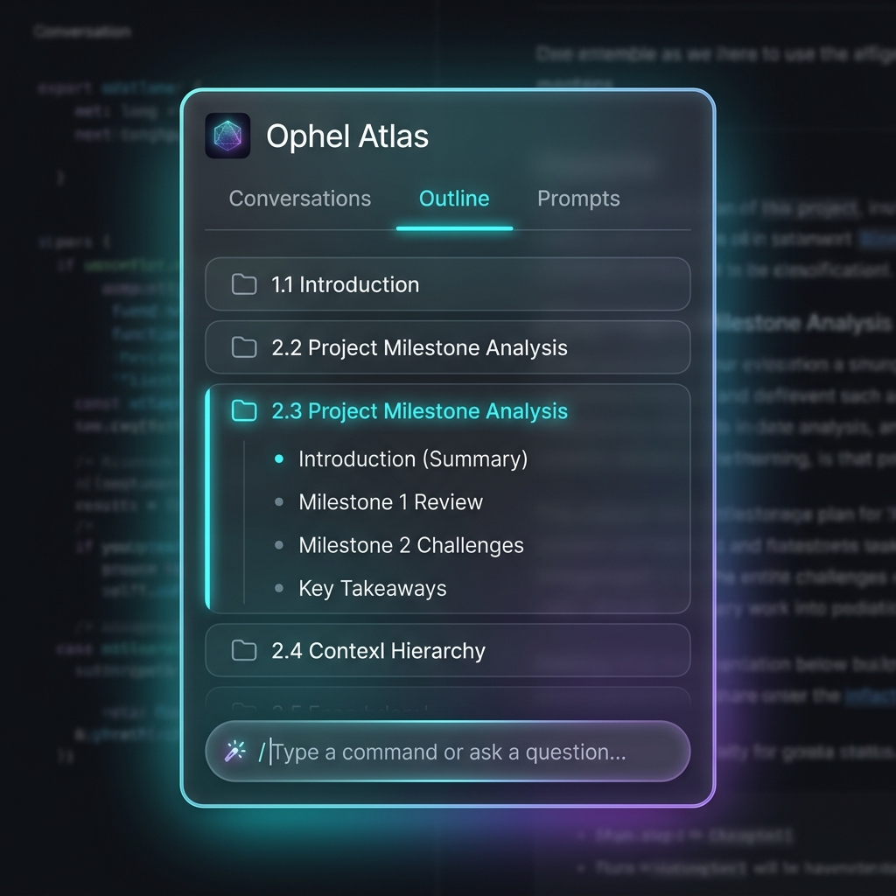
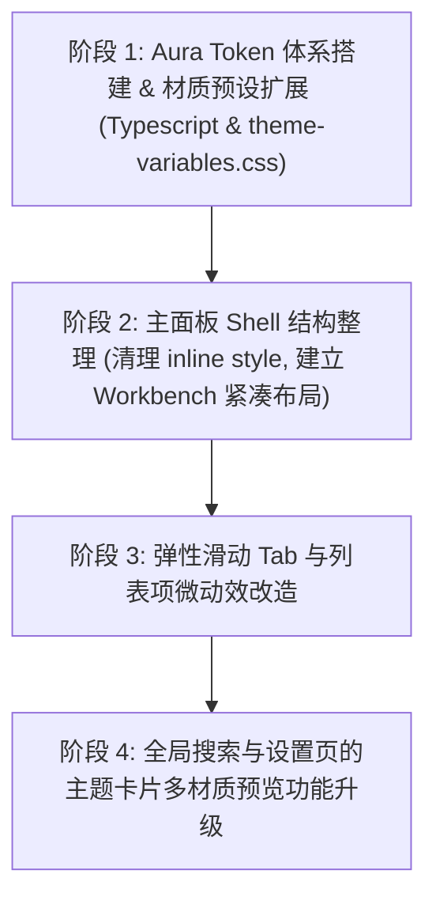

# Ophel Atlas UI 现代化重构方案：Aura Workbench (星影工作台)

本文档是针对 Codex “Atlas Workbench” 与 Gemini “Aura & Canvas” 的深度融合设计方案。

---

## 1. 核心博弈与合理性分析

在浏览器侧边扩展 UI 场景下，我们对两个设计方向进行了深度对比：

* **产品定位与信息密度**：
  * *Codex 方案 (Workbench)* 更合理。作为一个高频辅助工具，Ophel 必须保持高密度（Compact）、紧凑的间距和高度的可读性。过度留白（“呼吸感”）会严重牺牲 320px 面板在大纲和提示词列表上的信息承载力。
* **背景可读性 (CSP & 宿主环境不可控)**：
  * *Codex 方案 (Workbench)* 提出的“不透明兜底”更合理。如果主面板、设置项大面积使用强毛玻璃和发光，当用户在复杂的、高密度的网页背景（如彩色代码块、表格、长文本）上使用插件时，背景与面板文字会产生视觉交织，严重干扰阅读。
* **品牌精细度与视觉体验**：
  * *Gemini 方案 (Aura & Canvas)* 提出的“微动效、材质化映射、多语言排版”能带来真正的惊艳感（WOW Experience）。单纯的“变色调色盘”已无法满足现代高端用户，不同主题应当有材质与微交互差异。
* **工程可落地性与 Resiliency (鲁棒性)**：
  * 必须平衡维护成本。引入过多的动态 Token 会增加维护 24 套内置主题及自定义主题的开发心智负担。同时，**油猴脚本（Userscript）**环境没有扩展的隔离特权，容易受到宿主页面强严苛 CSP 的拦截。

### 最终抉择：双优融合版 —— **Aura Workbench (星影工作台)**

> **设计基线以 Atlas Workbench 为主，主题材质与微交互吸收 Aura & Canvas 的精华。**

* 基础组件结构、间距密度、文字大小及默认主题保持专业克制（高对比、高信息密度、不透明背景）。
* 动态毛玻璃、霓虹发光等高级材质仅在特定“高表达主题”及“局部微小悬浮件（如悬浮工具条）”上激活。
* 引入弹性 Tab 指示线、按钮物理压感、拖拽投影、骨架屏流光等精致微交互。
* 采用流式弹性 Flexbox 与右侧渐变淡出遮罩，优雅解决 10 种语言的长词排版截断问题。

### 1.1 风格描述

**Aura Workbench 是“高密度 AI 工具工作台 + 局部材质化主题表达”。**

它不是 Stripe 式营销页，也不是单一的玻璃拟态皮肤。更准确的参考组合是：

* **Raycast / Linear 的工具密度**：信息组织紧凑、操作路径短、状态清楚。
* **Arc / macOS HUD 的轻质材质**：只在浮层、工具条、主题预览等局部位置使用 blur、glow、radiant border。
* **Notion / Craft 的文本克制**：标题、正文、辅助信息层级明确，不用大字号和过度装饰抢内容注意力。

最终观感应当是：默认主题专业、安静、耐看；高表达主题有记忆点，但不牺牲阅读；所有主题共享同一套结构和交互，不出现“换主题等于换产品”的割裂感。

### 1.2 设计样图

当前样图用于表达视觉方向，不作为像素级实现稿：



---

## 2. 设计基线规范 (Workbench Layout Baseline)

### 2.1 紧凑间距与信息密度

主面板宽度自适应 320px - 450px，严格控制留白：
* **外边距与内边距**：面板主内容区内边距统一为 `12px` (`--gh-space-4`)，列表项行空隙为 `4px`。
* **高度定义**：Tab 栏高度统一为 `34px`，工具栏按钮 `28px`，列表项最小高度 `32px`，底部输入栏高度 `46px`。
* **文本密度**：主面板正文以 `13px` 为基准，重要标题使用 `14px / 600-650`；设置页正文以 `14px` 为基准，页面标题保留 `24px`。禁止使用随 viewport 缩放的字体。
* **触控兜底**：主面板高频 icon button 视觉尺寸可为 `28px`，但在触控或窄屏上下文中点击热区不得低于 `32px`；设置页与独立 Options 页面按钮热区优先接近 `36px`。

### 2.2 基础色彩与不透明度兜底
* **默认专业主题** (`classic-dark`, `google-gradient`, `mono-pro`, `nordic`)：
  使用不透明或接近不透明的背景（不透明度 `--gh-glass-opacity` 设为 `0.98`，模糊度仅设为 `4px` 消除边缘闪烁），保障纯工具场景下的绝对清爽和最高对比度。
* **大面积浮层隔离**：全局搜索弹窗、设置页的主体卡片默认采用不透明实色，不使用强毛玻璃，防止底图文字干扰。
* **高表达主题限制**：即使是 `unicorn-dream`、`sunset`、`aurora`、`cyberpunk` 等高表达主题，主面板主体背景也不得低于 `0.90` 不透明度；透明度低于 `0.85` 的材质只允许用于悬浮工具条、短暂 popover、装饰性边缘高光等非正文承载区域。
* **可读性优先**：任何材质效果都不能让正文、按钮文字、列表标题低于 WCAG AA 对比度目标。若主题色与背景混合后不达标，组件必须回退到不透明 surface token。

### 2.3 组件层级基线

所有主题共享同一套结构层级，主题只改变量，不改组件布局：

| 层级 | 适用组件 | 视觉原则 |
| :--- | :--- | :--- |
| Shell | 主面板、设置弹窗、全局搜索 | 稳定 surface、清晰边框、克制投影，优先保证可读 |
| Navigation | Header、Tabs、Sidebar、Rail | active 状态明确，不和 CTA 抢层级 |
| Content | 大纲项、会话项、提示词卡片、搜索结果 | 标题优先，辅助信息低饱和，行高固定 |
| Command | 工具栏按钮、底部按钮、添加提示词 | 常驻按钮降噪，主操作才使用强强调 |
| Feedback | loading、empty、error、success、drag/drop | 位置稳定，不靠颜色单独传达状态 |

---

## 3. 材质表达层规范 (Aura Theme Layer)

我们通过**最少扩展 Token 集合**，让 24 套主题在不改动组件结构的前提下，通过配置文件分流映射出不同的材质个性：

### 3.1 核心控制 Token 定义

```css
:host {
  /* 基础材质控制，在 theme-variables.css 中声明默认值 */
  --gh-glass-blur: 0px;             /* 模糊半径 */
  --gh-glass-opacity: 1.0;          /* 背景不透明度 */
  --gh-glass-border-opacity: 0.1;   /* 边框不透明度 */
  --gh-glow-shadow: none;           /* 外发光/呼吸阴影 */
  --gh-radius-factor: 1.0;          /* 圆角系数 */
}
```

#### 3.1.1 必填新增 Token 清单

以下 token 一旦进入 `ThemeVariables`，必须在 `theme-variables.css`、12 套浅色主题和 12 套深色主题中全部声明。自定义主题缺失这些变量时，必须由 `theme-variables.css` fallback 支撑。

| 分类 | Token | 用途 | 默认建议 |
| :--- | :--- | :--- | :--- |
| RGB | `--gh-bg-rgb` | 用于 rgba 背景混合 | 与 `--gh-bg` 对应 |
| RGB | `--gh-surface-rgb` | 卡片/面板 surface 透明混合 | 与 `--gh-card-bg` 或 `--gh-bg` 对应 |
| RGB | `--gh-primary-rgb` | glow、focus、混合色 | 与 `--gh-primary` 对应 |
| 材质 | `--gh-glass-blur` | blur 强度 | `0px` |
| 材质 | `--gh-glass-opacity` | 主 surface 不透明度 | `1` |
| 材质 | `--gh-glass-border-opacity` | 透明边框强度 | `0.12` |
| 材质 | `--gh-glow-shadow` | 主题外发光 | `none` |
| 材质 | `--gh-surface-texture` | 纹理背景，可为 `none` 或 data URI | `none` |
| 材质 | `--gh-radius-factor` | 主题圆角倍率 | `1` |
| Shell | `--gh-shell-bg` | 面板外壳背景 | `var(--gh-bg)` |
| Shell | `--gh-shell-surface` | header/footer/toolbar surface | `var(--gh-bg-secondary)` |
| Shell | `--gh-shell-surface-raised` | 浮起 surface | `var(--gh-card-bg)` |
| Shell | `--gh-shell-border` | 面板边框 | `var(--gh-border)` |
| Shell | `--gh-shell-shadow` | 面板投影 | `var(--gh-shadow)` |
| Tab | `--gh-tab-bg` | tab 区背景 | `var(--gh-bg-secondary)` |
| Tab | `--gh-tab-hover-bg` | tab hover | `var(--gh-hover)` |
| Tab | `--gh-tab-active-bg` | tab active surface | `var(--gh-bg)` |
| Tab | `--gh-tab-active-text` | tab active 文字 | `var(--gh-primary)` |
| Tab | `--gh-tab-active-indicator` | tab active 指示条 | `var(--gh-primary)` |
| Control | `--gh-control-bg` | icon/input/button 默认背景 | `var(--gh-bg)` |
| Control | `--gh-control-hover-bg` | control hover | `var(--gh-hover)` |
| Control | `--gh-control-active-bg` | control active | `var(--gh-active-bg)` |
| Control | `--gh-control-border` | control 边框 | `var(--gh-input-border)` |
| Control | `--gh-control-active-border` | control active 边框 | `var(--gh-primary)` |
| List | `--gh-list-item-hover-bg` | 列表 hover | `var(--gh-hover)` |
| List | `--gh-list-item-selected-bg` | selected 行背景 | `var(--gh-selected-gradient)` |
| List | `--gh-list-item-selected-border` | selected 行边框/左条 | `var(--gh-primary)` |
| List | `--gh-list-item-current-bg` | current/sync 当前行背景 | `var(--gh-outline-sync-bg)` |
| List | `--gh-list-item-current-border` | current/sync 当前行边框 | `var(--gh-outline-sync-border)` |
| Feedback | `--gh-focus-ring` | `:focus-visible` 轮廓 | `0 0 0 2px rgba(var(--gh-primary-rgb), 0.28)` |
| Feedback | `--gh-success` | 成功状态 | `#10b981` |
| Feedback | `--gh-warning` | 警告状态 | `#f59e0b` |
| Feedback | `--gh-error` | 错误状态 | `var(--gh-danger)` |
| Motion | `--gh-transition-fast` | hover/press 快速过渡 | `120ms ease-out` |
| Motion | `--gh-transition-smooth` | 普通过渡 | `180ms ease-out` |
| Motion | `--gh-transition-spring` | 弹性指示器 | `220ms cubic-bezier(0.34, 1.56, 0.64, 1)` |

#### 3.1.2 非必填派生 Token

以下变量可以不进入 `ThemeVariables`，优先在 CSS 中由必填变量派生，避免 24 套主题维护成本失控：

```css
--gh-panel-radiant-border: linear-gradient(
  135deg,
  rgba(var(--gh-primary-rgb), 0.35),
  rgba(var(--gh-surface-rgb), 0.08)
);
--gh-control-shadow-hover: 0 2px 8px rgba(var(--gh-primary-rgb), 0.12);
--gh-skeleton-shimmer: linear-gradient(
  90deg,
  transparent,
  rgba(var(--gh-primary-rgb), 0.08),
  transparent
);
```

### 3.2 24 套预设主题分流映射表

| 主题群组 (Theme Group) | 包含代表主题 | 主面板 `--gh-glass-blur` | 主面板 `--gh-glass-opacity` | 小浮层/rail opacity | `--gh-glow-shadow` | 材质观感 |
| :--- | :--- | :--- | :--- | :--- | :--- | :--- |
| **专业/克制 (Professional)** | `google-gradient`<br>`classic-dark`<br>`mono-pro`<br>`nordic` | `0px - 4px` | `0.98 - 1.0` | `0.94 - 0.98` | `none` | **黑曜石 / 珍珠白**：高可读，无背景干扰 |
| **艺术/高表达 (Expressive)** | `unicorn-dream`<br>`sunset`<br>`aurora`<br>`purple` | `8px - 14px` | `0.90 - 0.96` | `0.78 - 0.88` | `0 0 12px rgba(var(--gh-primary-rgb), 0.15)` | **彩色果冻 / 极光**：局部梦幻，主体仍可读 |
| **质感/实体 (Material)** | `ancient-scroll`<br>`coffee`<br>`porcelain` | `0px` | `1.0` | `0.96 - 1.0` | `0 4px 10px rgba(0,0,0,0.06)` | **羊皮纸 / 釉面陶瓷**：实体纹理，书卷气息 |
| **极客/高对比 (High Contrast)**| `cyberpunk`<br>`retro-terminal`<br>`eva-unit-01` | `0px - 4px` | `0.92 - 0.98` | `0.86 - 0.94` | `0 0 8px rgba(var(--gh-primary-rgb), 0.32)` | **CRT 全息 / 激光**：边缘发光，不牺牲正文 |

完整分组建议：

| 主题群组 | 浅色主题 | 深色主题 |
| :--- | :--- | :--- |
| Professional | `google-gradient`, `nordic`, `mono-pro` | `classic-dark`, `midnight-blue` |
| Expressive | `purple`, `ocean`, `mint`, `sakura`, `lemon-soda`, `unicorn-dream` | `sunset`, `aurora`, `deep-abyss`, `forest` |
| Material | `ancient-scroll`, `porcelain`, `shortbread` | `coffee` |
| High Contrast | 无 | `cyberpunk`, `dracula`, `retro-terminal`, `eva-unit-01`, `crimson-moon` |

#### 3.2.1 每个内置主题的建议材质值

实现时必须逐项补齐 12 套浅色和 12 套深色主题，不能只更新默认主题。

| 模式 | 主题 ID | 群组 | blur | shell opacity | rail/popover opacity | glow / texture 方向 |
| :--- | :--- | :--- | :--- | :--- | :--- | :--- |
| Light | `google-gradient` | Professional | `2px` | `0.99` | `0.96` | 无 glow，保留轻微品牌边框 |
| Light | `purple` | Expressive | `10px` | `0.94` | `0.84` | 紫色柔光，控制饱和度 |
| Light | `ocean` | Expressive | `8px` | `0.95` | `0.86` | 蓝绿色水面高光 |
| Light | `sakura` | Expressive | `8px` | `0.96` | `0.88` | 粉色低强度 glow |
| Light | `mint` | Expressive | `6px` | `0.96` | `0.88` | 清爽薄荷边缘光 |
| Light | `nordic` | Professional | `0px` | `1.0` | `0.98` | 冷灰金属，无彩色 glow |
| Light | `lemon-soda` | Expressive | `8px` | `0.95` | `0.86` | 黄色高光必须降低透明混合 |
| Light | `ancient-scroll` | Material | `0px` | `1.0` | `1.0` | 纸张纹理，暖色漫反射 |
| Light | `mono-pro` | Professional | `0px` | `1.0` | `0.98` | 黑白高对比，无材质干扰 |
| Light | `porcelain` | Material | `0px` | `1.0` | `0.98` | 陶瓷釉面，细边框高光 |
| Light | `shortbread` | Material | `0px` | `1.0` | `0.98` | 奶油纸感，弱颗粒纹理 |
| Light | `unicorn-dream` | Expressive | `14px` | `0.90` | `0.78` | 彩色 aura 只用于边缘和浮层 |
| Dark | `classic-dark` | Professional | `2px` | `0.99` | `0.96` | 黑曜石 surface，无常驻 glow |
| Dark | `midnight-blue` | Professional | `4px` | `0.98` | `0.94` | 深蓝低饱和边缘光 |
| Dark | `forest` | Expressive | `6px` | `0.96` | `0.88` | 绿色柔光，避免文字发绿 |
| Dark | `cyberpunk` | High Contrast | `0px` | `0.94` | `0.88` | 霓虹边线，不给正文 text-shadow |
| Dark | `coffee` | Material | `0px` | `1.0` | `0.98` | 温暖陶器/咖啡 crema 高光 |
| Dark | `sunset` | Expressive | `12px` | `0.92` | `0.82` | 橙粉色 glow，仅限浮层边缘 |
| Dark | `dracula` | High Contrast | `2px` | `0.96` | `0.90` | 紫粉强调，避免全局霓虹 |
| Dark | `deep-abyss` | Expressive | `8px` | `0.95` | `0.86` | 深海蓝低亮度 glow |
| Dark | `crimson-moon` | High Contrast | `2px` | `0.96` | `0.90` | 红色边缘警觉感，不污染危险状态 |
| Dark | `retro-terminal` | High Contrast | `0px` | `0.98` | `0.94` | CRT 线框感，禁止大面积模糊 |
| Dark | `eva-unit-01` | High Contrast | `0px` | `0.94` | `0.88` | 紫绿高对比，控制发光范围 |
| Dark | `aurora` | Expressive | `14px` | `0.90` | `0.80` | 极光色带只用于顶部/边框/预览 |

### 3.3 自定义主题兼容策略

自定义主题允许只声明旧变量，不强制用户补齐新变量。实现规则：

1. `theme-variables.css` 必须提供所有新增 token 的默认 fallback。
2. `parseThemeVariablesFromCSS()` 保持宽松解析，不因为自定义 CSS 缺少新增变量而报错。
3. `ThemeManager` 注入自定义 CSS 时不做结构性改写；组件 CSS 通过 `var(--new-token, var(--old-token))` 链式 fallback 兼容。
4. Options 页面主题编辑器可提示“建议补齐材质变量”，但不能阻断保存。

---

## 4. 微交互与多语言自适应

### 4.1 弹性微交互 (Tactile Micro-interactions)

* **弹性滑动 Tabs (Spring Slider)**：
  Tab 的 active 指示线使用绝对定位，利用 CSS 变量动态挂载横向偏移量和宽度，切换时采用弹性缓动曲线：
  ```css
  transition:
    left var(--gh-transition-spring),
    width var(--gh-transition-spring);
  --gh-transition-spring: 220ms cubic-bezier(0.34, 1.56, 0.64, 1);
  ```
* **按钮按压反馈 (Press Scale)**：
  列表内的小工具按钮和图标在被点击时有轻微的物理缩放：
  ```css
  .gh-btn-interactive:active { transform: scale(0.95); }
  ```
* **加载态流光 (Skeleton Shimmer)**：
  Loading 骨架屏使用 HSL 色调漂移的渐变横向滑过动画，拒绝简单的淡入淡出。

### 4.1.1 动效约束

动效只用于表达状态变化，不能成为装饰性常驻效果：

* Tab indicator、button press、drag/drop、toast enter、loading skeleton 可以使用动效。
* 面板常驻呼吸光、列表项无限闪烁、按钮持续跳动默认禁止。
* 必须支持 `prefers-reduced-motion: reduce`：关闭 spring、shimmer、glow pulse，保留即时状态变化。
* 微交互目标时长：hover/press `120ms - 180ms`；tab indicator `180ms - 240ms`；modal enter `180ms - 260ms`；禁止超过 `500ms` 的普通 UI 动画。

### 4.2 10 种语言自适应排版 (Multilingual Resilience)

* **流式弹性布局**：所有的控制栏、Tab 标题使用弹性伸缩，配合最小宽度兜底，杜绝德文和俄文单词溢出。
* **渐变溢出遮罩 (Fading Edge)**：
  当遇到不可避免的长词超出时，使用 `mask-image` 实现向右侧渐变淡出的视觉效果，取代生硬的 `...` 截断：
  ```css
  .gh-text-overflow-fade {
    white-space: nowrap;
    overflow: hidden;
    mask-image: linear-gradient(to right, black 85%, transparent 100%);
    -webkit-mask-image: linear-gradient(to right, black 85%, transparent 100%);
  }
  ```
* **优先保留可访问文本**：`mask-image` 只用于视觉截断，DOM 中仍保留完整文本和 `title` / aria label。按钮和 tab 的关键文案不能只靠图标或渐隐文本表达。
* **长词断行兜底**：设置页说明文本、搜索结果摘要、提示词标题允许 `overflow-wrap: anywhere`；主面板 tab 和窄按钮优先收缩或切换 icon-only。

---

## 5. 浏览器扩展与油猴脚本特有环境安全防范

### 5.1 规避宿主页面 CSP (内容安全策略) 拦截
* **现实边界**：当前项目已经通过 Plasmo `getStyle()` 与 `ThemeManager` 的 `#gh-theme-vars` 动态注入正常工作。不要因为抽象风险而默认推翻现有注入链路。
* **防御规则**：
  * **主路径不变**：继续使用 `ThemeManager.syncPluginUiTheme()` 生成主题 CSS，并追加到 Shadow Root 末尾，保证覆盖静态默认变量。
  * **属性直写仅作为 fallback**：只有在特定站点或油猴环境中确认 `<style>` 注入失败时，才退回到在 Shadow Host 或 `.gh-root` 上调用 `style.setProperty()` 写入主题变量。
  * **不得伪成功**：如果动态主题注入失败，应记录 `console.warn` 并回退默认主题变量，不能静默吞掉导致半主题状态。
  * **CSS 框架仍打包注入**：组件结构样式必须通过 `src/contents/ui-entry.tsx` 的 `getStyle()` 注入，不允许分散到运行时拼接字符串中。

### 5.2 应对毛玻璃效果 (`backdrop-filter`) 在 Stacking Context 下的失效
* **痛点**：若宿主页面容器包含 `contain: paint`、`transform` 或 `will-change`，会打断毛玻璃的底图像素读取，导致背景变为完全透明，内容与网页文本重合无法阅读。
* **防御规则**：
  * **不透明兜底背景 (Solid Fallback)**：在静态 CSS 中默认提供高对比的不透明兜底，只在 `@supports` 判定通过且未关闭毛玻璃的主题中激活透明模糊：
    ```css
    .gh-glass-panel {
      background: rgba(var(--gh-bg-rgb), 0.98); /* 默认接近不透明的背景色 */
    }

    @supports (backdrop-filter: blur(1px)) {
      .gh-glass-panel {
        background: rgba(var(--gh-bg-rgb), var(--gh-glass-opacity, 0.98));
        backdrop-filter: blur(var(--gh-glass-blur, 0px));
      }
    }
    ```
  * **高密度区域禁用强透明**：全局搜索结果列表、设置表单、提示词编辑器、大纲正文列表不允许使用低于 `0.90` 的背景不透明度。
  * **性能开关**：未来可在主题变量或设置项中引入 `--gh-enable-blur: 0/1` 的等价机制；第一阶段先通过主题组映射控制，不新增用户设置。

### 5.3 Shadow DOM 与主文档样式边界

* 插件面板、设置弹窗、全局搜索、提示词库等 Shadow DOM 内 UI 样式必须放在 `src/style.css`、`src/styles/settings.css`、`src/styles/conversations.css` 或通过 `ui-entry.tsx` 合并的新 CSS 文件中。
* `::view-transition-*` 等文档根伪元素仍只能由 `ThemeManager` 注入主文档 `document.head`。新增全局动画必须限定选择器和命名，避免污染宿主页。
* Gemini Enterprise 等第三方 Shadow DOM 样式场景不能复用插件 Shadow DOM 样式假设，需要单独确认注入目标。

---

## 6. 渐进式重构路线图



### 阶段 1：Aura Token 体系搭建与预置补齐

涉及文件：

* `src/utils/themes/types.ts`
* `src/styles/theme-variables.css`
* `src/utils/themes/light/index.ts`
* `src/utils/themes/dark/index.ts`
* `src/utils/themes/helpers.ts`
* `src/utils/storage.ts`
* `src/stores/settings-store.ts`
* `docs/developer/settings-schema.json`

实施内容：

1. 在 `ThemeVariables` 中新增必填 token。
2. 在 `theme-variables.css` 提供默认 fallback。
3. 为 12 套浅色、12 套深色预置补齐 token。
4. 确认 `themeVariablesToCSS()` 与自定义主题解析仍兼容。
5. 若新增 token 会影响备份/恢复或设置 schema，同步文档与默认设置。

验收：

* `pnpm typecheck` 通过。
* 所有内置主题无缺失 token。
* 旧自定义主题仍能加载，不出现空白面板或不可读文字。

### 阶段 2：主面板 Shell 结构整理

涉及文件：

* `src/components/MainPanel.tsx`
* `src/components/QuickButtons.tsx`
* `src/style.css`
* `src/contents/ui-entry.tsx`（仅在新增 CSS 文件时修改）

实施内容：

1. 将主面板 shell、header、tabs、footer 的 inline style 下沉为 class。
2. 组件只消费 `--gh-shell-*`、`--gh-tab-*`、`--gh-control-*`。
3. 保持面板拖拽、吸附、peek、悬浮模式的行为逻辑不变。
4. 先实现默认主题专业克制观感，再打开 Expressive / High Contrast 的材质差异。

验收：

* 320px、450px、600px 宽度下文字不重叠。
* 悬浮和吸附切换无布局跳动。
* 默认浅色、默认深色、`mono-pro`、`cyberpunk`、`unicorn-dream` 至少 5 套主题可读。

### 阶段 3：Tab、列表项与微交互改造

涉及文件：

* `src/components/OutlineTab.tsx`
* `src/components/PromptsTab.tsx`
* `src/components/ConversationsTab.tsx`
* `src/styles/conversations.css`
* `src/style.css`

实施内容：

1. 大纲、会话、提示词列表统一迁移到 list token。
2. 区分 hover、selected、current、locate、sync、dragging、drop-above/drop-below 状态。
3. 增加 tab indicator 与按钮 press feedback，并支持 `prefers-reduced-motion`。
4. 提示词卡片操作区降低静态噪声，hover/focus 时显现。

验收：

* 键盘 focus 与鼠标 hover 可区分。
* 拖拽排序时 drop target 在浅色、深色、高对比主题中都明确。
* reduced motion 下无弹性或流光动画，但功能状态仍明确。

### 阶段 4：全局搜索、设置页与主题预览升级

涉及文件：

* `src/styles/settings.css`
* `src/components/global-search/*`
* `src/tabs/options/pages/AppearancePage.tsx`
* `src/tabs/options/components/*`
* `src/components/SettingsModal.tsx`

实施内容：

1. 全局搜索结果 active、role badge、highlight、diagnostic 迁移到语义 token。
2. 设置页 sidebar、top tabs、setting card、slider、segmented control 使用相同 nav/tab/control token。
3. 主题卡片预览从“色点 + header”升级为 mini shell：显示 header、tab、list selected、primary control、材质差异。
4. 主题预览必须使用当前主题变量渲染，不能手写每套主题截图。

验收：

* Options 页面与 Shadow DOM 设置弹窗视觉一致。
* 全局搜索键盘导航状态清晰。
* 主题卡片能表达 Professional / Expressive / Material / High Contrast 的差异。

---

## 7. 验收矩阵

### 7.1 静态检查

实现阶段至少运行：

```bash
pnpm format:check
pnpm lint:check
pnpm typecheck
```

涉及主题注入、内容脚本、平台差异、油猴构建时追加：

```bash
pnpm build
pnpm build:userscript
```

### 7.2 视觉截图矩阵

最小截图范围：

| 界面 | 必测状态 |
| :--- | :--- |
| 主面板 - 大纲 | 空状态、普通列表、当前定位、搜索中、吸附/悬浮 |
| 主面板 - 提示词 | 分类、搜索、选中、添加按钮、编辑弹窗/抽屉 |
| 主面板 - 会话 | 文件夹、选中项、长标题、空状态 |
| 悬浮工具条 | 默认、hover、disabled、有锚点、吸附展开 |
| 全局搜索 | 输入、分类、active result、no results、diagnostic |
| 设置页 | 基本设置、外观主题、主题预览、自定义样式 |

最小主题集合：

| 类型 | 主题 |
| :--- | :--- |
| 默认浅色 | `google-gradient` |
| 默认深色 | `classic-dark` |
| 单色专业 | `mono-pro` |
| 高表达浅色 | `unicorn-dream` |
| 高表达深色 | `aurora` 或 `sunset` |
| 高对比 | `cyberpunk` 或 `retro-terminal` |
| 实体材质 | `ancient-scroll` 或 `porcelain` |
| 暖色深色 | `coffee` |

发布前应扫完 24 套内置主题，确保没有主题缺失变量、文字不可读或透明度过低。

### 7.3 可访问性与国际化验收

* 普通正文对比度目标不低于 WCAG AA 4.5:1。
* 所有 icon-only button 必须有 `aria-label` 或明确 tooltip。
* `Tab` 顺序与视觉顺序一致，焦点环可见。
* 10 种语言均不出现按钮文字溢出容器；德文、俄文、葡语长词至少有 fade 或 wrap fallback。
* `prefers-reduced-motion: reduce` 下不出现 spring、shimmer、pulse 等非必要动画。

### 7.4 实现前检查清单

开始写代码前，先确认以下条件：

* 新增 token 是否真的需要进入 `ThemeVariables`；如果能由 CSS 派生，不进入类型。
* 每个新增必填 token 是否已经覆盖 24 套预设主题。
* 自定义主题缺失新增 token 时是否仍有 `theme-variables.css` fallback。
* 是否误用了具体主题 ID 写组件分支；组件只能消费语义 token。
* 是否需要同步 `docs/developer/settings-schema.json`、备份/恢复兼容或默认设置。
* 是否影响扩展与油猴两个构建目标。

---

## 8. 不做事项

* 不把默认主题改成强毛玻璃、强发光、低透明度视觉。
* 不在组件中判断具体主题 ID 来写特例样式。
* 不新增只服务单个主题的组件分支。
* 不把外部网页背景当作可控设计素材。
* 不引入在线字体或远程图片资源。
* 不为了视觉效果牺牲 320px 主面板的信息密度。
